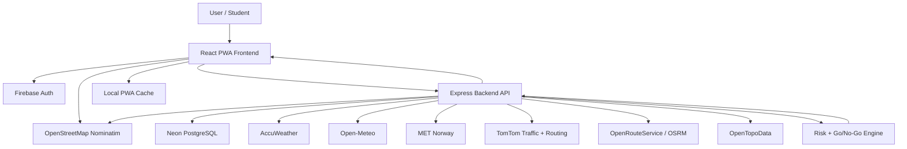

# SkyCheck Documentation

## 1. Project Overview

SkyCheck is a student commute decision-support system for Gordon College. It helps users decide whether they should go to school, proceed with caution, or avoid travel based on real-world conditions.

The system does not only show weather. It combines several commuter risk factors:

- Weather condition and rain probability
- Heat index
- Traffic condition
- Flood risk
- Saved route information
- School announcements
- Government advisories

The final output is a Go / No-Go decision:

- `GO` - conditions are generally safe
- `OWN_RISK` - user may proceed, but caution is needed
- `DO_NOT_GO` - travel is unsafe or unnecessary

The app also shows combined risk messages. Instead of saying "severe weather" for every high-risk case, SkyCheck explains the actual cause, such as high weather/heat risk, heavy traffic, flood risk, or a mixed condition like high weather risk with moderate traffic.

## 2. Problem Solved

Students often decide whether to go to school using incomplete information. Weather apps may show rain but not commute risk. Traffic apps may show road speed but not class status. School announcements may be separate from weather warnings.

SkyCheck brings those factors into one mobile-first app.

The problem areas addressed are:

- Sudden rain affecting student commuters
- Flood-prone routes
- Heat index and heat-related risk
- Traffic delays
- Lack of one place for commute-related decisions
- Low-connectivity situations where users still need their last known data

## 3. Target Users

Primary users:

- Gordon College students
- Student commuters in Olongapo, Subic, and Bataan
- Users who depend on walking, public transport, motorcycles, or ride-hailing

Secondary users:

- School offices that post class status
- Parents or guardians checking commute risk

## 4. Unique Value Proposition

SkyCheck is not just a weather app. It is a context-aware student commute assistant.

Its value is the combination of:

- Weather risk
- Traffic risk
- Flood risk
- Heat index
- Class status
- Government advisories
- Saved route monitoring with background risk checks
- Multi-transport fare estimates with regular and student/PWD/senior discounted fares
- Cause-aware risk explanations for weather/heat, traffic, flood, and mixed-risk combinations
- Offline cached decision support

Instead of asking "What is the weather?", SkyCheck answers: **"Should I go to school today?"**

## 5. System Architecture



## 6. Frontend Architecture

The frontend is located in `skycheck/`.

Main frontend responsibilities:

- User interface
- Firebase login, signup, email verification, and password reset
- Storing the JWT session from the backend
- Fetching dashboard weather, routes, alerts, announcements, and Go / No-Go results
- Persisting selected query data for offline mode (24-hour cache)
- Registering the PWA service worker
- Showing responsive layouts for mobile and desktop
- Requesting GPS access and applying the Olongapo fallback when a trusted in-area fix is unavailable
- Letting the user pick a starting point (current location or typed address) for routes to Gordon College

App screens (bottom navigation): Home (dashboard), Routes, Go/No-Go, Alerts, Profile. Announcements are reachable from the app as a separate page.

Important frontend tools:

- React for UI
- Vite for build tooling
- Tailwind CSS for styling
- TanStack Query and its persister for API state and local caching
- Zustand for lightweight app state (auth, GPS)
- Firebase SDK for authentication
- Leaflet for maps

## 7. Backend Architecture

The backend is located in `skycheck-backend/`.

Main backend responsibilities:

- REST API
- Firebase and Google token verification
- JWT session issuing
- User, route, alert, and announcement data storage
- Weather aggregation with provider fallback
- Traffic lookup
- Flood risk lookup
- Go / No-Go evaluation
- Scheduled risk checks for saved routes and morning alerts
- Verification and password-reset emails

Important backend tools:

- Express for API routing, with CORS and rate limiting
- Prisma for database access
- PostgreSQL / Neon for persistence
- Firebase Admin SDK and Google Auth Library for verifying ID tokens
- JSON Web Tokens for app session tokens (24-hour expiry)
- Node Cron for scheduled jobs
- Nodemailer for email (Gmail or custom SMTP)

## 8. Authentication Flow

SkyCheck uses Firebase Authentication for the identity layer, plus its own JWT session.

Supported sign-in methods:

- Email and password
- Google sign-in
- Password reset
- Email verification for manual signup

Flow:

1. User signs in through Firebase (or Google).
2. The frontend sends the ID token to the backend (`/auth/firebase` or `/auth/google`).
3. Backend verifies the token.
4. Backend finds or creates the user in PostgreSQL.
5. Backend returns a SkyCheck JWT.
6. Frontend uses the JWT for protected API requests.

Security measures:

- After 5 failed email/password logins, the account is locked for 15 minutes.
- Login, password-reset, and other sensitive endpoints are rate limited.
- Verification links expire after 24 hours and reset links after 1 hour.
- The backend records when a user was last active, which limits background work to active users (see section 13).

## 9. Weather System

### Providers and fallback order

The backend fetches weather for the Olongapo city center and caches it for 15 minutes. All users in the service area therefore see the same city-level weather, which keeps provider results stable and reduces API usage.

Provider order:

1. **AccuWeather** when `ACCUWEATHER_API_KEY` is set. It has a daily request budget (default 40) and a cooldown when the quota is hit.
2. **Open-Meteo** if AccuWeather is not configured or fails.
3. **MET Norway** if Open-Meteo fails or is rate-limited (Open-Meteo gets a 30-minute cooldown after a 429).
4. **Stale cache** (up to 6 hours old) if every provider is down.

The rain probability shown is AccuWeather's own hourly precipitation probability when AccuWeather is the source (no blending or inflation). The dashboard shows which provider supplied the reading (`Data: AccuWeather`, `Open-Meteo`, or `MET Norway`), and the backend logs the value on each fetch.

Collected weather variables include temperature, apparent temperature (feels-like), humidity, rain probability, precipitation, wind speed and gusts, weather code, and an hourly forecast (the dashboard shows the next 6 hours). With Open-Meteo, rain probability is calibrated using precipitation, cloud cover, and 15-minute precipitation signals.

### Accuracy and PAGASA

PAGASA has no official public weather API, so SkyCheck does **not** fetch data from PAGASA or Panahon.gov.ph. The weather values come from the providers above.

PAGASA is used in two other ways:

- Risk thresholds follow PAGASA references: the heat index bands (33°C and above is "Extreme Caution", 42°C and above is "Danger") and wind levels.
- PAGASA and other official advisories can be recorded as government announcements (source `PAGASA`, `NDRRMC`, `LGU_OLONGAPO`, and others). These are entered through the announcements API, not fetched automatically, and they feed the Go / No-Go decision.

Because the weather is city-level model data, it can differ from conditions on a specific street. Treat PAGASA bulletins as the official source during severe weather.

### Location behavior

The dashboard asks the user for GPS access and only trusts a fix that is precise enough (about 300 m or better) and inside the coverage area.

If GPS succeeds:

- The dashboard shows the geocoded place name for the user's position.
- A `Live +/-Xm` badge shows the browser-reported accuracy.
- The "use my current location" button can fill the route starting point.

If GPS is denied, unsupported, too imprecise, or outside the coverage area:

- SkyCheck uses the fallback `Olongapo, Zambales, Central Luzon` at `14.8386, 120.2842`.
- The user is told that precise location was unavailable and that mobile GPS is recommended.

This keeps the app useful on PC/laptop browsers, which may only provide rough Wi-Fi or IP-based location.

## 10. Traffic System

SkyCheck uses TomTom for live traffic. Google Maps is not used, because its traffic-aware routing requires a billing account (credit card). TomTom's free tier works without one.

### Saved routes and Go / No-Go with a route

1. **TomTom Routing** (preferred): one request follows the real road path from start to Gordon College and compares live travel time against free-flow travel time for the whole trip. This accounts for queues, closures, and incidents.
2. **TomTom Flow sampling** (fallback): samples current vs free-flow speed at the route start, middle, and destination and uses the worst reading.
3. **Rush-hour estimate** (last resort): a time-based heuristic.

### Dashboard (no route selected)

The backend samples TomTom flow at five points around the city center (about 1.5 to 2 km apart), which is more stable than a single GPS point.

### Risk levels

Traffic risk comes from the ratio of current speed (or travel time) to free-flow:

- Ratio below 0.50: `HIGH`
- Ratio below 0.75: `MEDIUM`
- Otherwise: `LOW`

### Fallback

If `TOMTOM_API_KEY` is missing, rejected, or rate-limited, SkyCheck uses a Philippine rush-hour heuristic (morning rush, lunch, evening rush, weekday vs weekend). Traffic does not become useless when the API fails, but it is an estimate, not a live reading.

The UI shows the source: `TomTom` when live data is used, `time based` for the heuristic, and `cached` when only stored route risk is available. Results are cached for 10 minutes.

## 11. Flood Risk System

Flood risk is estimated using:

- Elevation (OpenTopoData SRTM 30 m)
- Rainfall amount in mm (current and next-hour forecast)
- Rain probability, only as a confirming signal
- Route start and destination points

For routes, both endpoints are evaluated and the worse result is used.

**Rainfall amount is required.** A high chance of rain with no expected rainfall never raises flood risk. For example, 65% rain probability with 0 mm gives `LOW`.

Thresholds (calibrated for Central Luzon):

- Elevation at or below 8 m: low-lying zone. 8 mm or more rainfall gives `HIGH`; 3 mm or more (or 1 mm or more with a 70% or higher chance) gives `MEDIUM`.
- Elevation at or below 20 m: moderate zone. 8 mm or more gives `MEDIUM`, or `HIGH` if the chance is also 70% or higher.
- Above 20 m: `LOW`.

Flood risk categories are `LOW`, `MEDIUM`, `HIGH`, and `UNKNOWN`. `UNKNOWN` is used when the elevation service is unavailable. Elevation lookups are cached and throttled to stay within the free API limits.

## 12. Route System

### Fixed destination

Every route goes to **Gordon College, Bacon Street, West Tapinac, Olongapo City**. The destination is fixed in the frontend (`skycheck/src/constants/destination.ts`) and users cannot change it. Users only choose the starting point.

(The backend validates that both endpoints are inside the coverage area but does not itself force the destination to be Gordon College.)

### Choosing the starting point

In the Add Route sheet, the user can:

- Tap the current-location button to use GPS (reverse geocoded to an address), or
- Type an address and pick from search suggestions (OpenStreetMap Nominatim).

When the user already granted GPS, a new route is pre-filled with the current position. If GPS fails, an explanation is shown and the user can type the starting point instead.

### Coverage area

SkyCheck covers **Olongapo, Subic, and Bataan** (latitude 14.38 to 15.0, longitude 120.1 to 120.65). Starting points outside this area are rejected by both the frontend and backend.

### Saved route data

A route stores:

- Optional label
- Start address and coordinates
- Destination address and coordinates
- Departure time
- Distance and duration (OpenRouteService, with OSRM and a straight-line estimate as fallbacks)
- Last known risk (weather, traffic, flood, overall, basis, and time of check)

Each user can save up to 5 routes.

Route risk includes:

- Weather
- Traffic
- Flood
- Overall risk (the highest of the three)
- Risk basis explanation
- Combined risk headline explaining the main cause and secondary risks
- Traffic volume level (low, moderate, high)

Saved routes are refreshed by the backend and cached on the frontend. Offline mode can show the last cached routes, but adding, editing, and deleting routes require internet.

The route preview map uses Leaflet with MapTiler street tiles when a key is configured, otherwise OpenStreetMap tiles.

### Fare estimates

- Jeepney - based on LTFRB fare guidance for traditional and modern jeepneys; shown as conditional because a jeepney line must exist for the route.
- Tricycle - shown as conditional or limited because tricycle fares and routes are set by LGUs.
- Taxi - based on the LTFRB formula (flag-down, per-kilometer, per-minute).
- Maxim - app-based motorcycle estimate with a demand/availability buffer.

Each supported mode shows an original and a discounted estimate for student, PWD, and senior riders where the statutory discount applies. Maxim is shown separately because platform promos vary.

Fares are an estimate and budgeting aid, not an official fare matrix. Final fares may change due to local ordinances, route availability, traffic, waiting time, or app demand.

## 12.1 Combined Risk Messaging

SkyCheck takes the highest level among weather/heat, traffic, and flood risk as the overall risk. The UI then builds a readable message from the combination.

Examples:

- Weather/heat `HIGH`, traffic `MEDIUM`, flood `LOW`: high weather/heat risk with moderate traffic - consider delaying travel and prepare for harsh conditions
- Weather/heat `LOW`, traffic `HIGH`, flood `LOW`: high traffic risk - expect major delays and leave earlier
- Weather/heat `MEDIUM`, traffic `MEDIUM`, flood `LOW`: moderate weather/heat and traffic risk - bring protection and allow extra travel time
- Flood `HIGH` with any secondary risk: the message prioritizes flood safety and recommends avoiding low-lying routes

This prevents misleading messages such as "severe weather" when the real high-risk cause is traffic.

Note: the "weather risk" level itself is based on rain probability (70% or more is `HIGH`, 40% or more is `MEDIUM`). Heat and wind are reported through separate heat and tip messages.

## 13. Go / No-Go Engine

The Go / No-Go engine combines multiple factors into one decision.

Inputs:

- Weather risk (rain probability)
- Flood risk
- Traffic risk (with TomTom or time-based source)
- Heat index
- Rain probability and wind speed
- Selected route risk, if the user chooses a saved route
- School status (`F2F`, `ONLINE`, `HYBRID`, `SUSPENDED`)
- Government advisory severity (`INFO`, `ADVISORY`, `WARNING`, `CRITICAL`)

Outputs:

- Verdict
- Primary reason
- Safety score (0 to 100, higher is safer)
- One-sentence recommendation
- Factor-by-factor breakdown (each marked OK, CAUTION, or DANGER)

Example logic:

- Suspended classes produce `DO_NOT_GO`; online classes produce `OWN_RISK` because commuting is optional.
- A critical government advisory produces `DO_NOT_GO`.
- High weather risk can produce `OWN_RISK`.
- Combined severe weather and flood risk can produce `DO_NOT_GO`.
- Heat index at or above 33°C lowers the score, and at or above 42°C lowers it more.

If a saved route is selected, Go / No-Go evaluates fresh route-aware weather, flood, and TomTom traffic when possible, and otherwise falls back to the route's cached risk.

### Removed: health check

An earlier version asked users a daily symptom questionnaire (fever, cough, and so on) and fed it into the decision. It was removed because the answers are self-reported and can easily be manipulated or invalidated, so they are not a trustworthy safety input. Go / No-Go now uses only environmental and institutional data.

## 14. Alerts and Background Jobs

Two scheduled jobs run on the backend:

- **Risk refresh, every 15 minutes:** re-evaluates the risk of saved routes and creates an alert when a route's risk worsens to `MEDIUM` or `HIGH` and the user has alerts enabled. Only routes owned by recently active users are checked (default window 120 minutes, set by `ACTIVE_USER_WINDOW_MINUTES`) to save API quota.
- **Morning alerts, daily at 21:30 server time:** sends route risk alerts to active users who have morning alerts on. On a UTC server such as Render this is 5:30 AM Philippine time; no timezone is set in the code, so it follows the server clock.

Users can mark alerts as read or unread, and delete them. Profile preferences control morning alerts, alert sound, and vibration. Jobs can be disabled with `DISABLE_CRON`.

## 15. Announcements

- **School announcements** (`F2F`, `ONLINE`, `HYBRID`, `SUSPENDED`) feed the class-status factor.
- **Government announcements** (PAGASA, NDRRMC, LGU, CHED, DepEd) feed the advisory factor.

The app displays announcements, but there is no in-app admin screen. They are created through the API (`POST /announcements/school` and `POST /announcements/gov`). These endpoints currently require only a logged-in user, not an admin role, so a role check should be added before real use.

## 16. Offline / PWA Functionality

SkyCheck is installable as a PWA and supports offline access through cached data. The query cache is kept for up to 24 hours, and the service worker caches weather, elevation, map tiles, and backend responses for short periods.

Offline mode supports:

- Last cached weather dashboard
- Last cached route list
- Offline Go / No-Go estimate based on cached weather data

Offline mode does not support:

- Adding, editing, or deleting routes
- Searching new addresses
- Fetching new weather, traffic, flood data, or advisories

Offline Go / No-Go behavior:

1. User opens the Dashboard while online at least once, so weather is cached.
2. If the user goes offline, the Go / No-Go screen builds an estimate from the cached weather.
3. The government advisory factor is shown as not refreshed.

The app clearly labels the result as an offline estimate.

## 17. Database Models

Main Prisma models:

- `User` (account, verification and reset tokens, login lockout, notification preferences, last active time)
- `Route` (saved route and cached risk snapshot)
- `Alert` (`WEATHER`, `TRAFFIC`, or `FLOOD` alerts)
- `SchoolAnnouncement`
- `GovAnnouncement`

## 18. API Summary

All endpoints except authentication ones require a bearer JWT.

- `/auth` - `register`, `login`, `firebase`, `google`, `verify-email`, `resend-verification`, `forgot-password`, `reset-password`, `change-password`, `logout`, `me`, `preferences`
- `/weather` - current weather, 6-hour forecast, risk, and commute tips (`GET /weather?lat=&lon=`)
- `/routes` - list, `preview` (distance, time, fares), create, update, delete, and `:id/risk`
- `/alerts` - list, mark read/unread (single or all), delete
- `/go-no-go/evaluate` - Go / No-Go evaluation (`POST`, optional `routeId`)
- `/announcements` - list active school and government announcements, latest school status, and create/delete endpoints
- `/health-check-server` and `/health-server` - server status for uptime checks (unrelated to the removed user health check)

## 19. Environment Variables

### Frontend

```env
VITE_API_BASE_URL=
VITE_FIREBASE_API_KEY=
VITE_FIREBASE_AUTH_DOMAIN=
VITE_FIREBASE_PROJECT_ID=
VITE_FIREBASE_APP_ID=
VITE_FIREBASE_STORAGE_BUCKET=
VITE_FIREBASE_MESSAGING_SENDER_ID=
VITE_MAPTILER_KEY=
```

### Backend (required)

```env
DATABASE_URL=
JWT_SECRET=
NODE_ENV=
PORT=
FRONTEND_URL=
FIREBASE_PROJECT_ID=
FIREBASE_CLIENT_EMAIL=
FIREBASE_PRIVATE_KEY=
GOOGLE_CLIENT_ID=
EMAIL_USER=
EMAIL_PASS=
ORS_API_KEY=
TOMTOM_API_KEY=
```

### Backend (optional)

```env
ACCUWEATHER_API_KEY=                # enables AccuWeather as the primary provider
ACCUWEATHER_DAILY_REQUEST_BUDGET=   # default 40
ACCUWEATHER_REFRESH_MINUTES=        # default 90
MET_NO_USER_AGENT=                  # contact string required by MET Norway
SMTP_HOST= SMTP_PORT= SMTP_SECURE= SMTP_USER= SMTP_PASS= EMAIL_FROM=
EXTRA_ORIGINS=                      # extra allowed CORS origins
ACTIVE_USER_WINDOW_MINUTES=         # default 120
REQUIRE_EMAIL_VERIFICATION=
DISABLE_CRON=
```

## 20. Deployment Notes

Frontend is deployed on Vercel.

- Root directory: `skycheck`
- Build command: `npm run build`
- Output directory: `dist`

Backend is deployed on Render.

- Root directory: `skycheck-backend`
- Build command: `npm install --include=dev && npm run build`
- Start command: `npm start` (applies database migrations first)

Firebase Authentication authorized domains must include the deployed Vercel domain.

## 21. Accuracy Notes and Limitations

SkyCheck is a commute decision-support tool, not an official weather agency replacement.

Accuracy is supported by:

- Using AccuWeather with Open-Meteo and MET Norway as fallbacks, so one provider outage does not remove weather data
- Calibrating rain probability with precipitation, cloud cover, and 15-minute signals (Open-Meteo)
- Using heat index instead of temperature alone, with thresholds based on PAGASA's heat index scale
- Using TomTom route travel time for traffic instead of a single spot reading
- Adding flood context from elevation and rain
- Showing fallback estimates and labeling their source when live APIs fail
- Using trusted GPS coordinates only, with an Olongapo fallback
- Explaining mixed risk combinations instead of one overall label

Known limitations:

- Weather is city-level for Olongapo, not street-level, and does not come directly from PAGASA or Panahon.gov.ph.
- Traffic depends on the TomTom free tier. When it is unavailable, the time-based estimate is used.
- Flood risk is estimated from elevation and rain, not from official flood hazard maps or live water levels.
- Government advisories and school status must be entered manually; they are not fetched automatically.
- Location accuracy depends on the device. Mobile phones are usually more accurate; PC/laptop browsers may use rough Wi-Fi/IP estimates.

The app should be presented as a support tool that helps students make safer decisions, not as an absolute guarantee.

## 22. Presentation Questions and Answers

### Does this use emerging technology?

Yes. It uses a Progressive Web App design, real-time API integration, location-based risk analysis, Firebase authentication, and a decision engine that combines multiple live and cached data sources.

### What problem does it solve?

It helps students decide whether it is safe and practical to commute to Gordon College by combining weather, traffic, flood, and announcement data.

### Who are the target users?

Student commuters, especially Gordon College students and nearby commuters affected by rain, heat, traffic, and flooding.

### What technologies were used?

React, Vite, TypeScript, Tailwind CSS, Firebase Auth, Node.js, Express, Prisma, PostgreSQL, AccuWeather, Open-Meteo, MET Norway, TomTom, OpenRouteService, OpenTopoData, Vercel, and Render.

### How does offline mode work?

The PWA stores selected data locally. When offline, it can show cached weather and saved routes, and create an offline Go / No-Go estimate from cached weather.

### Is the app unique?

Many apps show weather or traffic separately. SkyCheck combines those with route risk, flood risk, school status, and offline support to answer a student-specific question: should I go to school today?

### How accurate is it?

It is more dependable than a single weather reading because it combines several factors and has fallbacks for each data source. However, it is a decision-support tool, not an official emergency warning system, and PAGASA remains the authority during severe weather.

### Why was the health check removed?

The health check relied on self-reported answers, which can easily be manipulated or invalidated. It was removed so decisions rely only on verifiable environmental and institutional data.

### Why TomTom and not Google Maps for traffic?

Google's traffic-aware routing requires a billing account. TomTom provides live route travel time and flow data without one. Google could be added as an optional higher-accuracy source if a billing account is available.

### What happens if GPS fails?

The app falls back to `Olongapo, Zambales, Central Luzon`, fetches weather and risk for that area, and tells the user that mobile GPS is recommended. The user can still type a starting point manually when adding a route.

## 23. Future Improvements

- Automatic PAGASA bulletin and advisory ingestion (no official API exists, so this would need scraping or a data partner)
- Optional Google Maps traffic as a higher-accuracy source
- Admin role and in-app screen for posting school and government announcements
- Push notifications for worsening route risk
- More precise flood mapping from official hazard maps
- More route waypoints for traffic and flood checking
- Street-level weather for saved routes instead of city-level
- Historical commute risk analytics
- Support for more campuses
- Removing the unused `HealthCheck` database table and model with a migration
